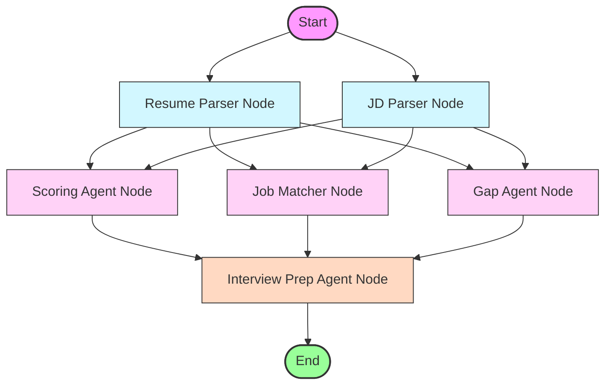

<!-- prettier-ignore -->
<div align="center">


# ResumeXAnalyzer

[](https://www.python.org/)
[](https://fastapi.tiangolo.com/)
[](https://ai.google.dev/)
[](https://langchain-ai.github.io/langgraph/)
<br>
[](https://nodejs.org/)
[](https://react.dev/)
[](https://www.typescriptlang.org/)
[](https://vite.dev/)

</div>

[Live Link 🚀](https://resume-x-analyzer.vercel.app/)

ResumeXAnalyzer is a multi-agent resume analysis and evaluation platform. It uploads a resume (PDF/DOCX) and matching Job Description (optional text), orchestrating a team of specialized AI agents built with LangGraph and powered by Gemini models to deliver structural data extraction, fit scoring, skill gap identification, local job matching, and customized interview preparation.

---

## Architecture

ResumeXAnalyzer uses **LangGraph** to construct a directed acyclic graph (DAG) representing the dependencies between specialized agents. This architecture enables parallel processing of documents and structured data flows.

### Pipeline Workflow

The compilation and path of state changes through the agents are shown below:



### Agent Roster

1. **Resume Parser (`backend/agents/resume_parser.py`)**: Extracts contact info, work experience, education, skills, and summary from raw text into a structured JSON payload.
2. **JD Parser (`backend/agents/jd_parser.py`)**: Extracts job titles, required skills, preferred qualifications, and experience thresholds. Handles empty or omitted JDs by outputting `null`.
3. **Scoring Agent (`backend/agents/scoring_agent.py`)**: Calculates scores (0-100) based on skills, experience, education, and professional presentation.
4. **Job Matcher (`backend/agents/job_matcher.py`)**: Matches extracted resume skills against a mock dataset of jobs to rank the top 5 matches.
5. **Gap Agent (`backend/agents/gap_agent.py`)**: Focuses on missing skills or credentials needed for the target job and suggests improvement paths.
6. **Interview Prep Agent (`backend/agents/interview_prep_agent.py`)**: Generates custom behavioral, technical, and gap-focused interview questions based on the candidate's profile.

---

## Key Features

- **Parallel Document Parsing**: Extracts structural data from PDF/DOCX resumes and Job Descriptions concurrently.
- **Dual Operating Modes**:
  - **JD-Aware**: Heavily weights analysis against the target job description to compute missing skills and alignment scoring.
  - **Standalone**: Executes general resume quality review, highlighting general areas for career growth and document layout optimizations.
- **Granular Scoring Metric**: Scores resumes out of 100 with distinct categorization (Excellent, Good, Fair, Needs Work) based on weighted factors:
  - **Skills Score**: (30% weight)
  - **Experience Score**: (25% weight in JD-aware, 35% in Standalone)
  - **Education Score**: (15% weight)
  - **Presentation Score**: (15% weight in JD-aware, 20% in Standalone)
  - **JD Alignment**: (15% weight, JD-aware only)
- **Simulated Job Matching**: Compares skills against a dummy database (`services/dummy_jobs.py`) using identical schemas to live job boards.
- **Robust Parsing & Retries**: Employs central clients (`services/gemini_client.py`) with retry-on-failure logic for LLM JSON extraction.

---

## Project Structure

```
├── backend/                         # FastAPI & LangGraph backend pipeline
│   ├── agents/                      # Specialized LangGraph agent nodes
│   ├── orchestrator/                # LangGraph definition and shared State schema
│   ├── services/                    # Text extraction, mock jobs, Gemini client
│   ├── tests/                       # Unit and integration tests
│   ├── main.py                      # Application entrypoint & FastAPI routers
│   └── config.py                    # Environment and settings configuration
│
└── frontend/                        # Vite + React + TypeScript frontend client
    ├── src/                         # Component and page sources
    ├── public/                      # Asset assets (favicon.svg, icons.svg)
    └── package.json                 # Dependency manifests
```

---

## Getting Started

### Prerequisites
- Python 3.13 or newer
- Node.js LTS
- A Gemini API Key or OpenRouter API Key

### Backend Setup

1. Navigate to the backend directory:
   ```bash
   cd backend
   ```
2. Create and configure your `.env` file from the example:
   ```bash
   cp .env.example .env
   ```
3. Set your environment variables inside `.env`:
   - `LLM_PROVIDER`: `gemini` or `openrouter`
   - `GEMINI_API_KEY`: Your Google Gemini API Key
   - `OPENROUTER_API_KEY`: Your OpenRouter API Key (if using OpenRouter)
4. Install dependencies and start the development server using `uv`:
   ```bash
   uv run uvicorn main:app --reload
   ```
   > [!NOTE]
   > The backend API will be running at `http://localhost:8000`. You can view the interactive OpenAPI documentation at `http://localhost:8000/docs`.

### Frontend Setup

1. Navigate to the frontend directory:
   ```bash
   cd ../frontend
   ```
2. Install dependencies:
   ```bash
   npm install
   ```
3. Start the development build server:
   ```bash
   npm run dev
   ```
   > [!NOTE]
   > The client website will run at `http://localhost:5173` (or the port specified by Vite in the terminal output).

---

## API Endpoints

- **GET `/health`**: Returns application status and the active model identifier.
- **POST `/api/analyze`**: Accepts multipart/form-data upload.
  - `resume`: PDF or DOCX file (up to 10MB)
  - `jd_text` (Optional): Target job description plain text